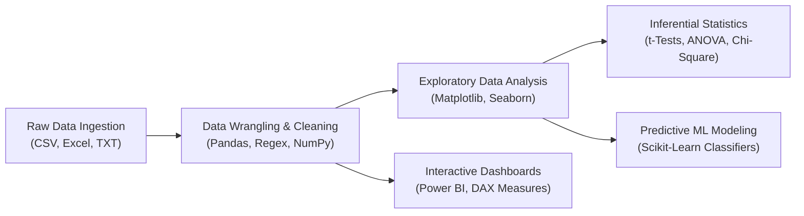
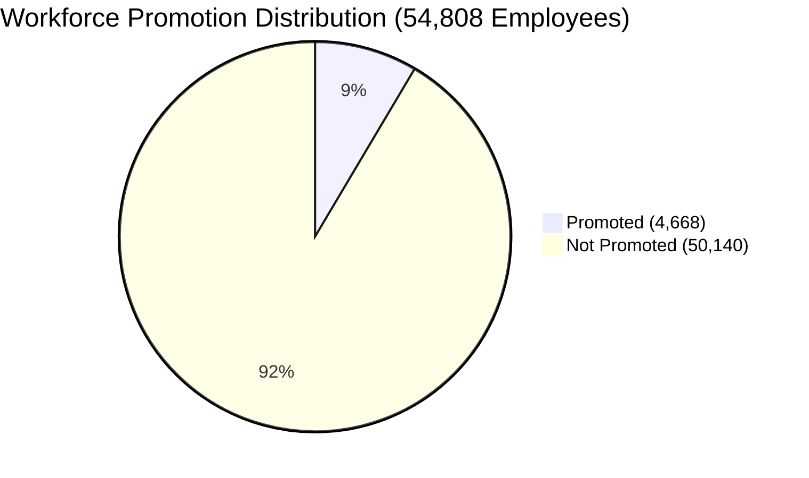
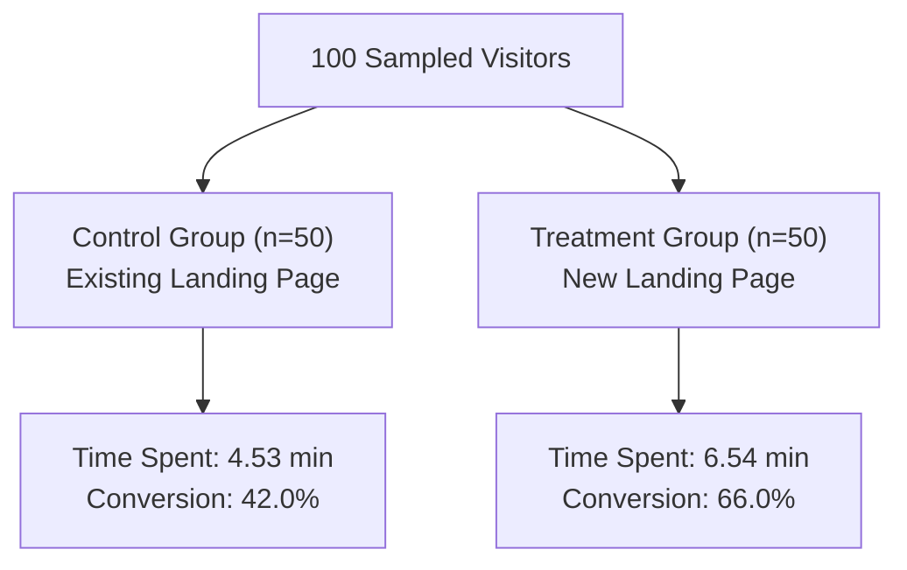
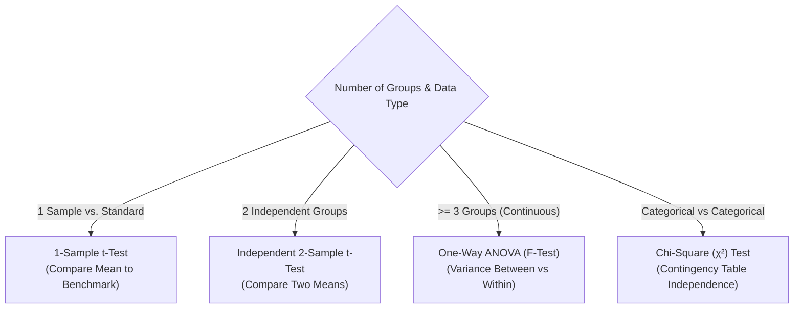

<div align="center">

# Enterprise Data Analysis, Statistical Inference & Business Intelligence Suite
### *End-to-End Analytics, Hypothesis Testing, Machine Learning & Executive Power BI Reporting*

[](https://www.python.org/)
[](https://jupyter.org/)
[](https://pandas.pydata.org/)
[](https://numpy.org/)
[](https://scikit-learn.org/)
[](https://powerbi.microsoft.com/)
[](https://opensource.org/licenses/MIT)

<p align="center">
  <b>Author:</b> Alvin Omedi (Omedi Alvin Eredi) &bull; 
  <b>Program:</b> CDAV (Continuous Data Analytics & Visualisation) &bull; 
  <b>Year:</b> 2026
</p>

</div>

---

## Table of Contents

- [Executive Summary](#-executive-summary)
- [Repository Architecture & File Map](#-repository-architecture--file-map)
- [Core Analytical Modules](#-core-analytical-modules)
- [Flagship Project 1: Enterprise HR Analytics & Promotion Prediction (Capstone)](#-flagship-project-1-enterprise-hr-analytics--promotion-prediction-capstone)
- [Flagship Project 2: E-News Express A/B Testing & Statistical Experimentation](#-flagship-project-2-e-news-express-ab-testing--statistical-experimentation)
- [Flagship Project 3: Retail & Urban Mobility Transaction Analytics](#-flagship-project-3-retail--urban-mobility-transaction-analytics)
- [Flagship Project 4: Inferential Statistics & Hypothesis Testing Engine](#-flagship-project-4-inferential-statistics--hypothesis-testing-engine)
- [Flagship Project 5: Automated Data Cleaning & Imputation Pipeline](#-flagship-project-5-automated-data-cleaning--imputation-pipeline)
- [Datasets Inventory & Data Dictionary](#-datasets-inventory--data-dictionary)
- [Technology Stack & Tooling](#-technology-stack--tooling)
- [Installation & Getting Started](#-installation--getting-started)
- [How to Run & Replicate Findings](#-how-to-run--replicate-findings)
- [Engineering Standards & Methodology](#-engineering-standards--methodology)
- [Author & Acknowledgments](#-author--acknowledgments)

---

## 🔭 Executive Summary

This repository hosts a production-grade data analytics, empirical hypothesis testing, predictive modeling, and business intelligence portfolio developed within the **CDAV (Continuous Data Analytics & Visualisation)** curriculum. 

The objective of this project is to bridge raw corporate and observational datasets with strategic executive decision-making. By applying modern data science methodologies, the codebase establishes a continuous pipeline across the full analytical lifecycle:

1. **Foundational Algorithmics & Python Syntax**: Idiomatic code structuring, vectorization, error handling, and clean modular computation.
2. **Robust Data Engineering & Wrangling**: Deep tabular cleaning, missing value resolution, regex-driven normalization, datetime transformations, and multidimensional aggregation.
3. **Rigorous Inferential Statistics & A/B Experimentation**: Parametric and non-parametric hypothesis tests ($Z$-tests, two-sample $t$-tests, Chi-Square tests of independence, and One-Way ANOVA) operating under strict $\alpha = 0.05$ decision criteria.
4. **Machine Learning & Predictive Modeling**: Supervised classification pipelines incorporating exploratory outlier filtering, standardization (`StandardScaler`), logistic regression, and performance metric validation.
5. **Interactive Executive Dashboards (Power BI)**: Business intelligence reports featuring dynamic DAX measures, KPI scorecards, drill-down matrices, and cross-filtering.

---

## Repository Architecture & File Map

The codebase is organized into modular directories separating foundational coursework, visualization laboratories, statistical assignments, dataset stores, and the enterprise capstone:

```text
data-analysis-and-BI-dashboard/
│
├── CapstoneProject/                     # Enterprise HR Analytics & Machine Learning Suite
│   ├── 168560-Alvin_Omedi.ipynb            # Primary Capstone Notebook (54k+ rows, EDA, Inferential Testing)
│   ├── trial1.ipynb                        # ML Classification & Predictive Modeling (Logistic Regression)
│   ├── AI_Job_Market_Dataset.csv           # Global AI Compensation & Hiring Demand Dataset
│   ├── datasets/                        # Capstone Datasets Repository
│   │   ├── hr2.csv                         # Master HR Dataset (54,808 rows, 14 features)
│   │   ├── trial1.csv                      # Test & Split Dataset for ML Modeling
│   │   └── trst1.xls                       # Supplementary Tabular Benchmark Records
│   ├── power bi/                        # Production Power BI Reports (.pbix)
│   │   ├── hr2.pbix                        # Executive Workforce & Promotion Analytics Dashboard
│   │   └── hr 3.pbix                       # Detailed Departmental & Retention Drill-Down Model
│   └── 168560-Alvin_Omedi/              # Archival Capstone Bundle & Student Submission
│       ├── 168560-Alvin_Omedi.ipynb        # Candidate Capstone Notebook
│       └── 168560-Alvin_Omedi.pbix         # Standalone Executive BI Report File
│
├── assignments/                         # Graded Statistical Assessments & Case Studies
│   ├── 168560-Alvin_Omedi.ipynb            # E-News Express A/B Testing & Business Statistics Project
│   ├── 168560_Alvin-Omedi.ipynb            # Retail (Coffee Shop) & Ride-Hailing Analytics with Pandas
│   ├── 168560_Alvin_Omedi.ipynb            # Comprehensive Take-Home Python Programming Assessment
│   ├── abtest.csv                          # A/B Testing Experiment Records (Control vs Treatment)
│   ├── Coffee_Shop_Sales.csv               # Retail Transaction Records (Sales, Products, Locations)
│   ├── Ride_Hailing_Trips.csv              # Urban Mobility Trip Logs (Durations, Fares, Ratings)
│   └── Problem Statement_E-News express.pdf# Formal Business Scenario & Hypothesis Guide
│
├── Visualisations/                      # Exploratory Data Visualization & Matplotlib Labs
│   ├── 03-03-26_Practise.ipynb             # Distributional Analysis & Plot Customization
│   ├── 04-03-26_assignment.ipynb           # Categorical Data Comparison & Multi-Panel Subplots
│   ├── 06-03-25.ipynb                      # Exploratory Visual Feature Extraction
│   ├── 11-03-26_Practise.ipynb             # Advanced Bivariate & Multivariate Relationship Plotting
│   ├── ClassGrades.ipynb                   # Academic Cohort Distribution & Performance Benchmarks
│   ├── gender_distribution.png             # Visual Output: Workforce Demographic Breakdown
│   └── part2b_oop_style.png                # Visual Output: Object-Oriented Matplotlib Canvas
│
├── Python Foundations/ # Step-by-Step Programming Mastery
│   ├── 01-Introduction to Python Statements.ipynb  # Syntax Principles, Code Blocks & Indentation
│   ├── 02-if, elif, and else Statements.ipynb      # Conditional Branching & Multi-Branch Logic
│   ├── 03-for Loops.ipynb                          # Iteration Patterns, Nested Loops & Accumulators
│   ├── 04-while Loops.ipynb                        # Indefinite Iteration, Break/Continue/Pass Control
│   ├── 05-Useful-Operators.ipynb                   # Enumerate, Zip, Range, Random & In Operator
│   ├── Syntax.ipynb                                # Data Types, Type Casting & Variable Mechanics
│   ├── 22-01-26.ipynb & First Program.ipynb        # Hands-on Class Demonstrations & Logic Testing
│   ├── CDAV 2026 Practice Exercises.ipynb          # 20+ Guided Programming Drills & Algorithmic Tasks
│   └── GroupAssign.ipynb                           # Collaborative Lab Project & Vectorized Exercises
│
├── Data Wrangling & Analysis Engines    # Tabular Transformation & Statistical Notebooks
│   ├── Pandas_cleaning.ipynb               # End-to-End Messy Data Cleaning (customer_call_list.xlsx)
│   ├── pandas_section.ipynb                # DataFrame Construction, Indexing & Aggregations
│   ├── statistics_section.ipynb            # Descriptive & Inferential Hypothesis Testing Engine
│   └── exercise.ipynb                      # NumPy Low-Level Text Parsing & Array Manipulations
│
├── Root Datasets & Runtime Artifacts
│   ├── customer_call_list.xlsx             # Raw Unstructured Customer Directory
│   ├── netflix_csv.csv                     # Netflix Global Titles & Genre Catalog
│   ├── student_performance.csv             # Student Academic Performance & Attendance Dataset
│   ├── sales_data.txt                      # Raw Whitespace-Delimited Matrix Data
│   └── app.py                              # Environment Sanity & Execution Verification Script
│
├── requirements.txt                        # Clean, Reproducible Python Dependency Matrix
├── .gitignore                              # Production Git Ignore Configuration
└── README.md                               # Repository Master Documentation
```

---

## Core Analytical Modules



### 1. Algorithmic Python & Vectorized Foundations
- In-depth coverage of Python memory semantics, dynamic typing, truth value testing, and flow control.
- Elimination of slow nested Python loops through vectorized array operations in NumPy and Pandas Series broadcasting.
- Implementation of defensive exception handling, type casting, and string formatting.

### 2. Tabular Cleaning & Feature Engineering
- Automated detection and removal of redundant duplicates across composite primary keys.
- Robust imputation strategies: median imputation for skewed continuous distributions, mode imputation for categorical attributes, and conditional string replacements.
- Regular expression (regex) cleaning for non-standard telephone numbers, email addresses, and postal strings.
- Feature extraction: temporal splitting (extracting month, weekday, and year from timestamps), composite revenue metrics (`Quantity * UnitPrice`), and categorical binning.

### 3. Parametric & Non-Parametric Hypothesis Testing
- Formulation of formal $H_0$ (Null) and $H_a$ (Alternative) hypotheses.
- Assumption validation: verification of normality (Shapiro-Wilk / Q-Q plots) and equality of variances (Levene's test).
- Two-sample independent $t$-tests to evaluate mean performance divergence across treatment groups.
- One-Way Analysis of Variance (ANOVA) to assess variance across $\ge 3$ categorical segments.
- Pearson's Chi-Square ($\chi^2$) Contingency Tests of Independence for categorical association.

### 4. Interactive Power BI Dashboard Architecture
- Multi-table star and snowflake relational data models connecting transactional logs to dimensional tables.
- Advanced DAX (Data Analysis Expressions) calculated columns, explicit measures, and dynamic time-intelligence calculations.
- Executive view with KPI cards, dynamic slicers (department, education, gender, region), cross-filtering, and heatmaps.

---

## Flagship Project 1: Enterprise HR Analytics & Promotion Prediction (Capstone)

*Notebook:* [`CapstoneProject/168560-Alvin_Omedi.ipynb`](file:///c:/Users/alvin/Desktop/Projects/CDAV/data-analysis-and-BI-dashboard/CapstoneProject/168560-Alvin_Omedi.ipynb)  
*Power BI Reports:* [`CapstoneProject/power bi/hr2.pbix`](file:///c:/Users/alvin/Desktop/Projects/CDAV/data-analysis-and-BI-dashboard/CapstoneProject/power%20bi/hr2.pbix) & [`168560-Alvin_Omedi.pbix`](file:///c:/Users/alvin/Desktop/Projects/CDAV/data-analysis-and-BI-dashboard/CapstoneProject/168560-Alvin_Omedi/168560-Alvin_Omedi.pbix)  
*Primary Dataset:* [`CapstoneProject/datasets/hr2.csv`](file:///c:/Users/alvin/Desktop/Projects/CDAV/data-analysis-and-BI-dashboard/CapstoneProject/datasets/hr2.csv) (54,808 records)

### Business Context & Challenge
Large-scale enterprises frequently struggle with subjective, delayed, or biased promotion pipelines. This project analyzes **54,808 employee records** across 9 departments and 34 geographical regions to uncover the structural determinants of career progression, evaluate talent equity, and identify unpromoted high-performing talent.



### Key Analytical Findings & Metrics

| Metric / Dimension | Observation | Strategic Takeaway |
|:---|:---|:---|
| **Class Imbalance** | 4,668 Promoted (8.5%) vs. 50,140 Non-Promoted (91.5%) | Severe 10.7:1 imbalance requires precision metrics rather than baseline accuracy. |
| **Top Promotion Departments** | Technology (10.76%), Procurement (9.64%), Analytics (9.57%) | Technical and quantitative functions demonstrate higher career progression velocity. |
| **Lagging Departments** | Sales & Marketing (7.20%), Legal (5.10%) | High headcount functions exhibit promotional bottlenecks. |
| **Regional Dispersion** | Region 4 (14.45%), Region 17 (13.69%) vs. Region 2 (8.01%) | Major promotional rate variance across operational clusters. |
| **Training Score Threshold** | Scores $\ge 95$ have an observed promotion probability $\approx 100\%$ | Rigorous training completion serves as a direct pipeline to leadership roles. |
| **High-Potential Cohort** | **9,015 unpromoted employees (16.4% of total workforce)** | Employees with top previous ratings ($\bar{x} = 3.89$), avg service of 5.4 yrs; immediate targets for retention. |

### Inferential Hypothesis Testing: Training Score Impact
- **Research Question:** *Is there a statistically significant difference in the average training score between promoted and non-promoted employees?*
- **Hypotheses:**
  $$H_0: \mu_{\text{promoted}} = \mu_{\text{non-promoted}} \quad \text{vs.} \quad H_a: \mu_{\text{promoted}} > \mu_{\text{non-promoted}}$$
- **Test Type:** Two-sample independent $t$-test (upper-tailed) at $\alpha = 0.05$.
- **Statistical Output:** 
  $$\text{T-statistic} = 38.83 \quad \vert \quad p\text{-value} = 0.0000 \quad (p < 10^{-15})$$
- **Decision & Conclusion:** Since $p < 0.05$, we decisively **reject the null hypothesis ($H_0$)**. Training scores represent a statistically significant differentiator in promotion likelihood.

### Machine Learning Predictive Model (`trial1.ipynb`)
- Formulated a supervised classification pipeline using **Logistic Regression** to predict promotion and loan eligibility statuses.
- Executed feature scaling via `StandardScaler()` to eliminate magnitude bias across training scores, lengths of service, and ages.
- Evaluated classification boundaries using 80/20 train-test splits and accuracy metrics.

---

## Flagship Project 2: E-News Express A/B Testing & Statistical Experimentation

*Notebook:* [`assignments/168560-Alvin_Omedi.ipynb`](file:///c:/Users/alvin/Desktop/Projects/CDAV/data-analysis-and-BI-dashboard/assignments/168560-Alvin_Omedi.ipynb)  
*Dataset:* [`assignments/abtest.csv`](file:///c:/Users/alvin/Desktop/Projects/CDAV/data-analysis-and-BI-dashboard/assignments/abtest.csv) ($n = 100$)  
*Significance Level:* $\alpha = 0.05$

### Business Context & Experimental Design
E-news Express, an online news portal, observed a decline in new monthly subscriber acquisition. The UX/Product design team developed a revamped landing page featuring an updated layout and personalized recommendation engine. 

To determine whether the new layout outperforms the existing layout, a randomized controlled trial (A/B Test) was conducted with **100 visitors** equally divided into:
- **Control Group ($n=50$):** Served the existing landing page.
- **Treatment Group ($n=50$):** Served the redesigned landing page.



### Statistical Tests Matrix

| Research Question | Statistical Test Applied | Null Hypothesis ($H_0$) | $p$-Value | Empirical Decision | Business Conclusion |
|:---|:---|:---|:---|:---|:---|
| **1. Time Spent on Page** | Two-Sample Independent $t$-Test (One-Tailed) | $\mu_{\text{new}} \le \mu_{\text{old}}$ | **$p < 0.001$** | **Reject $H_0$** | Users spend statistically significantly more time on the new landing page. |
| **2. Conversion Rate** | Two-Proportion $Z$-Test (One-Tailed) | $p_{\text{new}} \le p_{\text{old}}$ | **$p = 0.008$** | **Reject $H_0$** | The conversion rate on the new page is significantly greater than the old page. |
| **3. Language Dependency** | Chi-Square ($\chi^2$) Test of Independence | Conversion is independent of language | **$p > 0.05$** | **Fail to Reject $H_0$** | Conversion status does not depend on the reader's preferred language. |
| **4. Multi-Language Engagement** | One-Way ANOVA ($F$-Test) | $\mu_{\text{English}} = \mu_{\text{French}} = \mu_{\text{Spanish}}$ | **$p > 0.05$** | **Fail to Reject $H_0$** | Reading time on the new landing page is uniform across all supported languages. |

### Managerial Recommendation
**Adopt the new landing page immediately.** The empirical evidence confirms that the redesign drives both higher user engagement (dwell time) and a significantly higher subscription conversion rate, without alienating any linguistic demographic.

---

## Flagship Project 3: Retail & Urban Mobility Transaction Analytics

*Notebook:* [`assignments/168560_Alvin-Omedi.ipynb`](file:///c:/Users/alvin/Desktop/Projects/CDAV/data-analysis-and-BI-dashboard/assignments/168560_Alvin-Omedi.ipynb)  
*Datasets:* `Coffee_Shop_Sales.csv` & `Ride_Hailing_Trips.csv`

### Retail Operations Analytics (Coffee Shop Chain)
- **Data Engineering:** Parsed ISO transaction dates into native datetime objects; performed compound duplicate detection on `TransactionID`; imputed missing city entries.
- **Feature Synthesis:** Generated total transactional revenues in Kenya Shillings (`Revenue_KES = Quantity * UnitPrice_KES`) and temporal groupings.
- **Aggregated Performance:** Ranked top-selling SKUs (Lattes, Espressos, Cappuccinos) across Mombasa, Nairobi, and Kisumu branches, identifying peak sales hours and promotional lift.

### Urban Mobility & Transport Services (Ride Hailing)
- **Operational Metrics:** Computed trip duration efficiency ratios (`Duration_min / Distance_km`), driver rating distribution profiles, and revenue per kilometer across vehicle tiers.
- **Payment Distribution:** Contrasted digital payments (Card, Mobile Money) against cash payments, establishing driver satisfaction correlations with digital tipping.

---

## Flagship Project 4: Inferential Statistics & Hypothesis Testing Engine

*Notebook:* [`statistics_section.ipynb`](file:///c:/Users/alvin/Desktop/Projects/CDAV/data-analysis-and-BI-dashboard/statistics_section.ipynb)  
*Dataset:* [`student_performance.csv`](file:///c:/Users/alvin/Desktop/Projects/CDAV/data-analysis-and-BI-dashboard/student_performance.csv)

### Comprehensive Descriptive Profiling
- **Central Tendency & Dispersion:** $\bar{x}_{\text{FinalGrade}} = 80.2$, $\bar{x}_{\text{Attendance}} = 85.6\%$, average weekly study hours = $17.7\text{ hrs}$.
- **Positional Quantiles & Deciles:**
  - $Q_1 = 73.5$, Median ($Q_2$) = $82.5$, $Q_3 = 87.75$.
  - Interquartile Range ($\text{IQR} = 14.25$) utilized for robust upper and lower outlier gating ($\text{Q1} - 1.5\times\text{IQR}$ and $\text{Q3} + 1.5\times\text{IQR}$).
  - Percentile tracking ($P_{1} = 62.54$, $P_{99} = 91.82$) defining exceptional performance bands.

### Statistical Testing Protocol Implemented



1. **One-Sample $t$-Test (Two-Tailed):** Validated cohort mastery against historic grading benchmark ($\mu_0 = 75$).
2. **Two-Sample Independent $t$-Test:** Compared final grade outcomes between high-attendance and low-attendance cohorts.
3. **One-Way ANOVA:** Assessed grade homogeneity across varying levels of parental support (High, Medium, Low).
4. **Chi-Square Test of Independence:** Examined relationship between extracurricular participation and academic performance tiers.

---

## Flagship Project 5: Automated Data Cleaning & Imputation Pipeline

*Notebook:* [`Pandas_cleaning.ipynb`](file:///c:/Users/alvin/Desktop/Projects/CDAV/data-analysis-and-BI-dashboard/Pandas_cleaning.ipynb)  
*Dataset:* [`customer_call_list.xlsx`](file:///c:/Users/alvin/Desktop/Projects/CDAV/data-analysis-and-BI-dashboard/customer_call_list.xlsx)

This project tackles messy, unstructured enterprise customer registries, transforming noisy records into an analytics-ready database:

- **String Stripping & Regex Cleaning:** Removed stray special characters (`/`, `_`, `|`, `...`) from string columns using vectorized `.str.strip()` and regex substitution.
- **Phone Number Normalization:** Cleaned varying numeric phone string formats (`123-456-7890`, `123/456/7890`, `1234567890`, `N/A`) into uniform 10-digit standardized expressions.
- **Categorical & Boolean Mapping:** Standardized ambiguous boolean strings (`'Y'`, `'Yes'`, `'N'`, `'No'`, `'NaN'`) into clean boolean `True`/`False` states.
- **Address & Geographical Splitting:** Separated combined address strings into discrete `Street_Address`, `State`, and `Zip_Code` columns.
- **Do-Not-Call Compliance Filtering:** Filtered out records flagged with `Do_Not_Contact == 'Yes'` or blank phone records to produce a clean outbound sales roster.

---

## Datasets Inventory & Data Dictionary

| Dataset File | File Type | Primary Records | Dimensions / Key Attributes | Analytical Use Case |
|:---|:---:|:---|:---|:---|
| [`hr2.csv`](file:///c:/Users/alvin/Desktop/Projects/CDAV/data-analysis-and-BI-dashboard/CapstoneProject/datasets/hr2.csv) | CSV | 54,808 | 14 columns: `department`, `region`, `training_score`, `is_promoted` | Enterprise Capstone, EDA, Hypothesis Testing, Power BI |
| [`abtest.csv`](file:///c:/Users/alvin/Desktop/Projects/CDAV/data-analysis-and-BI-dashboard/assignments/abtest.csv) | CSV | 100 | 6 columns: `user_id`, `group`, `time_spent`, `converted`, `language` | A/B Testing, Two-sample $t$-test, ANOVA, $\chi^2$ Test |
| [`AI_Job_Market_Dataset.csv`](file:///c:/Users/alvin/Desktop/Projects/CDAV/data-analysis-and-BI-dashboard/CapstoneProject/AI_Job_Market_Dataset.csv) | CSV | 10,000+ | 19 columns: `job_title`, `salary`, `skills_python`, `experience` | Tech Market Trends, Salary Distribution, Skills Impact |
| [`Coffee_Shop_Sales.csv`](file:///c:/Users/alvin/Desktop/Projects/CDAV/data-analysis-and-BI-dashboard/assignments/Coffee_Shop_Sales.csv) | CSV | Transactional | `TransactionID`, `Date`, `City`, `Product`, `Revenue_KES` | Retail Sales Trends, Feature Engineering, Aggregation |
| [`Ride_Hailing_Trips.csv`](file:///c:/Users/alvin/Desktop/Projects/CDAV/data-analysis-and-BI-dashboard/assignments/Ride_Hailing_Trips.csv) | CSV | Transactional | `TripID`, `PickupCity`, `Distance_km`, `Fare_KES`, `Rating` | Urban Mobility Analytics, Trip Duration & Fares |
| [`customer_call_list.xlsx`](file:///c:/Users/alvin/Desktop/Projects/CDAV/data-analysis-and-BI-dashboard/customer_call_list.xlsx) | Excel (.xlsx) | 30+ | `CustomerID`, `Phone_Number`, `Paying Customer`, `Address` | Data Cleaning Pipeline, Regex Parsing, Imputation |
| [`student_performance.csv`](file:///c:/Users/alvin/Desktop/Projects/CDAV/data-analysis-and-BI-dashboard/student_performance.csv) | CSV | Academic | `AttendanceRate`, `StudyHours`, `PreviousGrade`, `FinalGrade` | Descriptive Statistics, Quartiles, Hypothesis Testing |
| [`netflix_csv.csv`](file:///c:/Users/alvin/Desktop/Projects/CDAV/data-analysis-and-BI-dashboard/netflix_csv.csv) | CSV | 8,800+ | `show_id`, `type`, `title`, `director`, `release_year`, `rating` | Catalog Distribution, Categorical Analysis |
| [`sales_data.txt`](file:///c:/Users/alvin/Desktop/Projects/CDAV/data-analysis-and-BI-dashboard/sales_data.txt) | TXT | Tabular | Whitespace-delimited numeric sales records | Low-level NumPy Array Parsing & Mathematical Vectorization |

---

## 🛠 Technology Stack & Tooling

```text
Analytics & Engineering Ecosystem
├── Language: Python 3.13.8
├── Data Wrangling: Pandas 3.0.0, NumPy 2.4.1, OpenPyXL 3.1.5
├── Statistical Testing: SciPy 1.17.0, Statsmodels 0.14.6
├── Machine Learning: Scikit-Learn 1.8.0
├── Visualizations: Matplotlib 3.10.8, Seaborn 0.13.2
├── Business Intelligence: Microsoft Power BI Desktop (DAX, Power Query)
└── Notebook Environments: JupyterLab 4.0, IPython 9.9
```

---

## Installation & Getting Started

### Prerequisites
- **Python:** 3.10 or higher (Tested and developed on Python 3.13.8)
- **Package Manager:** `pip` (or `conda`)
- **Dashboard Viewer:** Microsoft Power BI Desktop (Windows) to inspect `.pbix` files.

### 1. Clone the Repository
```bash
git clone https://github.com/ErediAlvin/data-analysis-and-BI-dashboard.git
cd data-analysis-and-BI-dashboard
```

### 2. Configure Virtual Environment

#### On Windows (PowerShell):
```powershell
# Create virtual environment
python -m venv venv

# Activate virtual environment
.\venv\Scripts\Activate.ps1
```

#### On macOS / Linux (Bash):
```bash
# Create virtual environment
python3 -m venv venv

# Activate virtual environment
source venv/bin/activate
```

### 3. Install Dependencies
```bash
pip install --upgrade pip
pip install -r requirements.txt
```

### 4. Register Jupyter Kernel
```bash
python -m ipykernel install --user --name=cdav-env --display-name="Python (CDAV)"
```

### 5. Launch Jupyter Environment
```bash
jupyter lab
# or
jupyter notebook
```

---

## How to Run & Replicate Findings

### Replicating the Capstone HR Analysis
1. Launch Jupyter Lab and open [`CapstoneProject/168560-Alvin_Omedi.ipynb`](file:///c:/Users/alvin/Desktop/Projects/CDAV/data-analysis-and-BI-dashboard/CapstoneProject/168560-Alvin_Omedi.ipynb).
2. Ensure kernel is set to `Python (CDAV)`.
3. Select **Kernel $\to$ Restart Kernel and Run All Cells**.
4. Observe the clean EDA distribution plots, high-potential employee filter tables, and two-sample $t$-test output ($T=38.83, p=0.0000$).

### Replicating the E-News Express A/B Test
1. Open [`assignments/168560-Alvin_Omedi.ipynb`](file:///c:/Users/alvin/Desktop/Projects/CDAV/data-analysis-and-BI-dashboard/assignments/168560-Alvin_Omedi.ipynb).
2. Run sequentially through Sections 1 through 4 to compute the $t$-statistic, $Z$-statistic, Chi-Square contingency table, and ANOVA $F$-statistic.
3. Review the statistical outputs verifying the business recommendation to launch the new landing page.

### Inspecting Power BI Dashboards
1. Open Microsoft Power BI Desktop.
2. Open [`CapstoneProject/power bi/hr2.pbix`](file:///c:/Users/alvin/Desktop/Projects/CDAV/data-analysis-and-BI-dashboard/CapstoneProject/power%20bi/hr2.pbix) or [`CapstoneProject/168560-Alvin_Omedi/168560-Alvin_Omedi.pbix`](file:///c:/Users/alvin/Desktop/Projects/CDAV/data-analysis-and-BI-dashboard/CapstoneProject/168560-Alvin_Omedi/168560-Alvin_Omedi.pbix).
3. Interact with the multi-dimensional slicers (Department, Education, Region) to dynamically update the executive KPI cards, promotion rate metrics, and demographic distributions.

---

## Engineering Standards & Methodology

This codebase enforces strict production data analysis standards:

1. **Object-Oriented Plotting:** Prioritizes Matplotlib's explicit `fig, ax = plt.subplots()` API over implicit stateful plotting, ensuring modular chart customization and crisp figure exports.
2. **Vectorization Over Iteration:** Avoids Python `for` loops on tabular records, utilizing native Pandas vectorized string, mathematical, and temporal methods for optimal execution speed.
3. **Rigorous Statistical Verification:** Strictly mandates the 5-step hypothesis testing protocol:
   - *Step 1:* Clear null ($H_0$) and alternative ($H_a$) mathematical hypotheses.
   - *Step 2:* Model selection based on sample size, variance knowledge, and normality.
   - *Step 3:* Significance level specification ($\alpha = 0.05$).
   - *Step 4:* Calculation of test statistics and exact $p$-values.
   - *Step 5:* Direct mapping from statistical decision to actionable managerial business recommendations.

---

## Author & Acknowledgments

- **Lead Analyst & Developer:** **Alvin Omedi (Omedi Alvin Eredi)**
- **GitHub:** [@ErediAlvin](https://github.com/ErediAlvin)
- **Academic Program:** **CDAV (Continuous Data Analytics & Visualisation)**
- **Academic Year:** 2026

---

<div align="center">
  <sub>Built with precision and passion for modern data science. Licensed under the MIT License.</sub>
</div>
